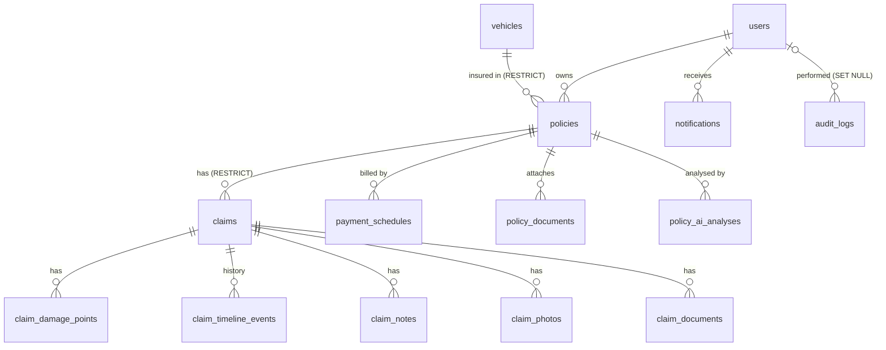

# DATABASE SCHEME

Vehicle Insurance Application — PostgreSQL schema (database `vehicle_insurance_db`).

- Managed by **Flyway**; source of truth is `src/main/resources/db/migration/V*.sql`.
- Hibernate runs with `ddl-auto: validate`, so every entity must match a table here.
- Primary keys are `UUID` (`gen_random_uuid()`, via the `pgcrypto` extension) unless noted.
- Rule: never edit an applied migration — add a new `V<n>__*.sql` file.

## Entity Relationship Diagram

All foreign keys are `ON DELETE CASCADE` unless marked otherwise above.

## Tables

### users (V1, V16)
| Column | Type | Constraints / Default |
|---|---|---|
| id | UUID | PK |
| name | VARCHAR(150) | NOT NULL |
| email | VARCHAR(255) | NOT NULL, UNIQUE |
| password_hash | VARCHAR(255) | NOT NULL (bcrypt) |
| phone | VARCHAR(20) | NOT NULL |
| role | VARCHAR(20) | NOT NULL, default `USER`; CHECK `USER` \| `ADMIN` |
| status | VARCHAR(20) | NOT NULL, default `ACTIVE`; CHECK `ACTIVE` \| `SUSPENDED` |
| address | VARCHAR(255) | nullable (V16) |
| email_notifications | BOOLEAN | NOT NULL, default `true` (V16) |
| sms_notifications | BOOLEAN | NOT NULL, default `false` (V16) |
| in_app_notifications | BOOLEAN | NOT NULL, default `true` (V16) |
| created_at / updated_at | TIMESTAMP | NOT NULL, default `now()` |

Index: `idx_users_email` on `LOWER(email)`. A seed admin account is inserted by V1
(`admin@vehicle.com`); change its password outside local development.

### vehicles (V3)
| Column | Type | Constraints / Default |
|---|---|---|
| id | UUID | PK |
| make | VARCHAR(100) | NOT NULL |
| model | VARCHAR(100) | NOT NULL |
| year | VARCHAR(4) | NOT NULL |
| registration_no | VARCHAR(20) | NOT NULL, UNIQUE |
| vehicle_type | VARCHAR(20) | NOT NULL; CHECK `two-wheeler` \| `car` \| `suv` \| `commercial` |
| created_at / updated_at | TIMESTAMP | NOT NULL, default `now()` |

Index: `idx_vehicles_registration_no` on `UPPER(registration_no)`.

### policies (V4)
| Column | Type | Constraints / Default |
|---|---|---|
| id | UUID | PK |
| user_id | UUID | NOT NULL, FK → users(id) CASCADE |
| vehicle_id | UUID | NOT NULL, FK → vehicles(id) RESTRICT |
| policy_number | VARCHAR(50) | NOT NULL, UNIQUE |
| insurance_company | VARCHAR(150) | NOT NULL |
| coverage_type | VARCHAR(20) | NOT NULL; CHECK `comprehensive` \| `third-party` \| `own-damage` |
| start_date | DATE | NOT NULL |
| end_date | DATE | NOT NULL; CHECK `end_date > start_date` |
| status | VARCHAR(20) | NOT NULL, default `ACTIVE`; CHECK `ACTIVE` \| `EXPIRED` \| `RENEWED` \| `CANCELLED` \| `PENDING` |
| premium_amount | INTEGER | NOT NULL, default 0 (pre-calculated at creation) |
| notes | TEXT | nullable |
| created_at / updated_at | TIMESTAMP | NOT NULL, default `now()` |

Indexes: `user_id`, `vehicle_id`, `UPPER(policy_number)`.

### policy_documents (V15)
Backs `Policy.documents` (ordered element collection: RC, PUC, previous policy).
| Column | Type | Constraints |
|---|---|---|
| policy_id | UUID | FK → policies(id) CASCADE |
| position | INTEGER | order within the policy |
| document_url | VARCHAR(500) | NOT NULL |

PK: `(policy_id, position)`.

### policy_ai_analyses (V18)
AI extraction results for an uploaded policy document.
| Column | Type | Constraints / Default |
|---|---|---|
| id | UUID | PK |
| policy_id | UUID | NOT NULL, FK → policies(id) CASCADE |
| status | VARCHAR(50) | NOT NULL |
| policy_number_extracted, insurer_extracted, policyholder_name_extracted | VARCHAR(255) | nullable |
| start_date_extracted, end_date_extracted, payment_interval_extracted | VARCHAR(50) | nullable |
| premium_extracted, idv_extracted, deductible_extracted | VARCHAR(100) | nullable |
| confidence | DOUBLE PRECISION | nullable |
| raw_structured_result | TEXT | nullable |
| conflicts | TEXT | nullable |
| model_provider | VARCHAR(100) | nullable |
| analyzed_at | TIMESTAMPTZ | nullable |
| source_document_url | VARCHAR(500) | nullable |
| error_message | TEXT | nullable |
| created_at / updated_at | TIMESTAMPTZ | NOT NULL, default `NOW()` |

Index: `idx_policy_ai_analyses_policy_id`.

### claims (V6)
| Column | Type | Constraints / Default |
|---|---|---|
| id | UUID | PK |
| claim_number | VARCHAR(50) | NOT NULL, UNIQUE |
| policy_id | UUID | NOT NULL, FK → policies(id) RESTRICT |
| accident_date | DATE | NOT NULL |
| location | VARCHAR(255) | NOT NULL |
| description | TEXT | NOT NULL |
| status | VARCHAR(20) | NOT NULL, default `Filed` (`Filed` \| `Under Review` \| `Approved` \| `Rejected` \| `Closed`) |
| estimated_amount, actual_amount | INTEGER | nullable |
| filed_date | DATE | NOT NULL |
| vehicle_make, vehicle_model | VARCHAR(100) | NOT NULL (snapshot) |
| registration_no | VARCHAR(20) | NOT NULL (snapshot) |
| damage_eligibility | VARCHAR(30) | null until reviewed |
| ai_confidence | INTEGER | 0–100, null until assessed |
| created_at / updated_at | TIMESTAMP | NOT NULL, default `now()` |

Indexes: `policy_id`, `UPPER(claim_number)`.

### claim_damage_points (V6)
| Column | Type | Constraints |
|---|---|---|
| id | BIGSERIAL | PK |
| claim_id | UUID | NOT NULL, FK → claims(id) CASCADE |
| area | VARCHAR(100) | NOT NULL |
| severity | VARCHAR(20) | NOT NULL (`Low` \| `Medium` \| `High` \| `Critical`) |
| description | VARCHAR(500) | NOT NULL |

### claim_notes / claim_photos / claim_documents (V6, V14)
Ordered element collections on `Claim`; PK `(claim_id, position)`, FK → claims(id) CASCADE.
| Table | Value column |
|---|---|
| claim_notes | `note` TEXT NOT NULL |
| claim_photos | `photo_url` VARCHAR(500) NOT NULL |
| claim_documents | `document_url` VARCHAR(500) NOT NULL (FIR, licence, etc.) |

### claim_timeline_events (V7)
Ordered history of what happened to a claim.
| Column | Type | Constraints |
|---|---|---|
| id | BIGSERIAL | PK |
| claim_id | UUID | NOT NULL, FK → claims(id) CASCADE |
| status | VARCHAR(30) | NOT NULL |
| note | VARCHAR(500) | nullable |
| created_at | TIMESTAMP | NOT NULL, default `now()` |

### payment_schedules (V9, V17)
One row per premium installment. "Overdue" is derived at read time, not stored.
| Column | Type | Constraints / Default |
|---|---|---|
| id | UUID | PK |
| policy_id | UUID | NOT NULL, FK → policies(id) CASCADE |
| installment_number | INTEGER | NOT NULL |
| amount | INTEGER | NOT NULL |
| due_date | DATE | NOT NULL |
| status | VARCHAR(20) | NOT NULL, default `Pending` (`Pending` \| `Paid`) |
| paid_date | DATE | nullable |
| receipt_no | VARCHAR(50) | UNIQUE |
| payment_interval | VARCHAR(20) | NOT NULL, default `one-time` (`one-time` \| `monthly` \| `quarterly` \| `half-yearly` \| `annually`) (V17) |
| reminder_sent | BOOLEAN | NOT NULL, default `false` (V17) |
| created_at / updated_at | TIMESTAMP | NOT NULL, default `now()` |

Index: `policy_id`.

### notifications (V10)
| Column | Type | Constraints / Default |
|---|---|---|
| id | UUID | PK |
| user_id | UUID | NOT NULL, FK → users(id) CASCADE |
| type | VARCHAR(20) | NOT NULL (`payment` \| `claim` \| `policy` \| `system`) |
| title | VARCHAR(150) | NOT NULL |
| message | VARCHAR(500) | NOT NULL |
| icon | VARCHAR(30) | NOT NULL (lucide-react icon name) |
| read | BOOLEAN | NOT NULL, default `false` |
| created_at | TIMESTAMP | NOT NULL, default `now()` |

Indexes: `user_id`, `(user_id, read)`.

### audit_logs (V12)
Immutable "who did what" trail; `user_name` is snapshotted so entries survive user changes.
| Column | Type | Constraints / Default |
|---|---|---|
| id | UUID | PK |
| user_id | UUID | nullable, FK → users(id) SET NULL |
| user_name | VARCHAR(150) | NOT NULL |
| action | VARCHAR(20) | NOT NULL (`CREATE` \| `UPDATE` \| `APPROVE` \| `REJECT` \| `SUSPEND` \| `CLOSE` \| `PAYMENT` \| `LOGIN` \| `UPLOAD`) |
| entity | VARCHAR(50) | NOT NULL (e.g. `Policy`, `Claim`) |
| entity_id | VARCHAR(100) | NOT NULL |
| ip_address | VARCHAR(45) | nullable |
| created_at | TIMESTAMP | NOT NULL, default `now()` |

Indexes: `created_at DESC`, `entity`.

## Notes

- **Empty migrations:** `V2__create_refresh_tokens_table.sql`, `V5__create_applications_table.sql`,
  `V11__create_documents_table.sql` and `V13__create_system_settings_table.sql` are currently
  0-byte files, so those tables (`refresh_tokens`, `applications`, `documents`, `system_settings`)
  do **not** exist in the schema. They are reserved version slots; fill them in only if the
  features are built (and never after they have been applied to a real database with different content).
- Money columns (`premium_amount`, `amount`, `estimated_amount`, `actual_amount`) are whole `INTEGER` values.
